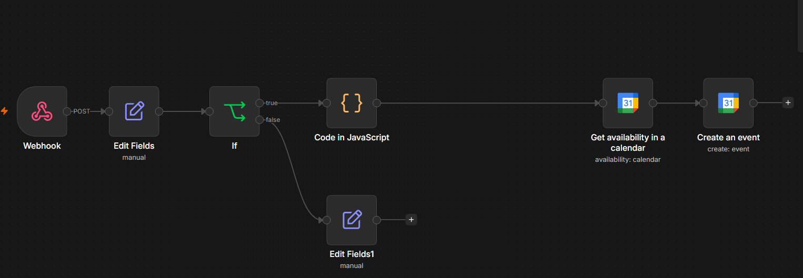

# Automação de Agendamento com Google Calendar



Sistema que recebe agendamentos via formulário, verifica a disponibilidade na agenda e cria o evento automaticamente — tudo orquestrado no **n8n**.

## O que ele resolve

**Antes:** o barbeiro recebia pedidos de agendamento por WhatsApp, precisava conferir manualmente se o horário estava livre, responder o cliente e depois criar o evento na agenda.

**Depois:** o cliente preenche um formulário, o sistema checa a agenda em tempo real e cria o evento sozinho. O barbeiro só precisa olhar o calendário.

## Como funciona o fluxo


[Tally Form] ──▶ Webhook (n8n)
                    │
                    ▼
              [Extrai campos]
                    │
                    ▼
           [Valida se tem horário] ──(vazio)──▶ Retorna erro ao cliente
                    │
                  (ok)
                    │
                    ▼
          [Calcula slot de 30min]
                    │
                    ▼
         [Checa Google Calendar]
                    │
                    ▼
       [Cria evento no Calendar]

## Stack utilizada

- **n8n** (hospedado em VPS Linux) — orquestração do fluxo
- **Webhook** — recebe o POST do formulário
- **Tally** — formulário de agendamento
- **Google Calendar API** — verificação de disponibilidade e criação do evento
- **JavaScript** (nó Code) — cálculo do slot e validação de dados

## Como rodar este projeto

1. Importe o arquivo `workflow.json` no seu n8n.
2. Configure a credencial OAuth2 do Google Calendar.
3. Atualize o e-mail no campo `calendar` dos dois nós do Google Calendar.
4. Ative o workflow e copie a URL de produção do Webhook.
5. Aponte o seu formulário (Tally, Typeform, etc.) para essa URL.

## Teste rápido (cURL)

```bash
curl -X POST https://seu-dominio.com/webhook/tally-agendamento \
  -H "Content-Type: application/json" \
  -d '{
    "data": {
      "fields": [
        {"label": "Seu Nome", "value": "João"},
        {"label": "Seu WhatsApp", "value": "32999999999"},
        {"label": "Qual horário fica melhor para você?", "value": "14:00"},
        {"label": "Serviços", "value": ["id1"], "options": [{"id": "id1", "text": "Corte"}]}
      ]
    }
  }'
